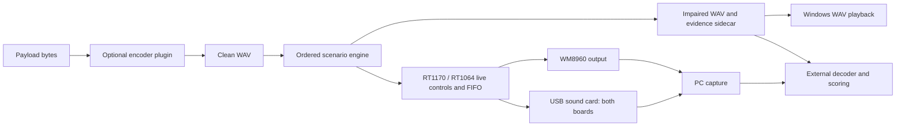

# Waveform generator

SPDX-FileCopyrightText: 2026 Paul R. Decker

See [COPYRIGHT](COPYRIGHT) for the
scope of project copyright. Project code is licensed under **GPL-3.0-only**.
Third-party components retain their own licenses; see
[third-party notices](THIRD_PARTY_NOTICES.md).

Create repeatable 48 kHz test audio, mix controlled interference into it, and
save or play the result on Windows or supported **MIMXRT1170-EVK** and
**MIMXRT1064-EVK** boards over USB audio. Both builds include the WM8960 codec
route; analog codec operation has not been qualified on the RT1064.
The default build plays supplied WAV files and applies interference. Optional
user-supplied encoder plugins are selected at build time and generate waveform
files at runtime.

## 50,000-foot view



| Capability | Current implementation |
|---|---|
| Generate clean vectors | Calibration tone script; optional user-supplied encoder plugins |
| Mix a retained WAV | `signal_lab_render`: CW, band-limited AWGN, impulses, fades, sample slips |
| Hear a WAV on the PC | `host/play_wav.py`: explicit WASAPI output, including the selected output device |
| Play on the board | `rt1170-player-*` and `rt1064-player-*`: SD file player, static scenarios, live CW/static/fade controls; WM8960 or USB sound card output |
| Record evidence | `waveform_capture`: WinMM or raw WASAPI input, analog or the board's USB sound card |
| Reproduce a live experiment | Acknowledged frame-indexed journals and offline replay |

PC playback is a Python/PortAudio convenience player for already-rendered WAVs.
The C++ engine does not yet have a native Windows live output backend or a GUI.
Its deterministic artifact can be replayed through Windows shared-mode audio;
Windows volume, processing and the DAC affect the physical result.

[RT1064 port and bring-up guide](docs/modules/rt1064-board.md) covers its
shared USB/SD player and board-specific setup. The RT1170 target details are in
[RT1170 Player and Audio](docs/modules/rt1170-player-and-audio.md). Physical
USB workflows for either board are in the [Windows USB bench guide](docs/windows-usb-bench.md);
reproducible test procedures and acceptance boundaries are in
[Testing](docs/testing.md).

Start with the [quick start](docs/quickstart.md) for a local tone, an interference
render and PC playback. The [complete how-to](docs/how-to-use.md) gives the
implemented-feature map, use cases, downloaded-WAV and supplied-WAV recipes,
board CDC workflow, and entry points for every command and switch. Use the
[feature-status matrix](docs/feature-status.md) to distinguish complete,
partial/experimental and planned capabilities. Use the
[CLI reference](docs/modules/command-line-tools.md) for tool options and the
[WFG-LIVE/1 reference](docs/live-control-protocol.md) for wire commands and
reply fields. Module authors can follow the
[encoder tutorial](docs/custom-encoder-tutorial.md).
For M110 transmit vectors, the optional
[modem-core adapter](examples/modem-core-encoder/README.md) uses the public
`modem-core` transmitter through the same encoder interface. Its host output
has been checked against the reference transmitter, and both board firmware
builds pass their stack checks. Bench playback for this adapter remains to be
verified.

## 1. Get dependencies and build

Run these commands from this repository root. Install Git, Python 3.10 or newer,
CMake 3.27 or newer, and a C++23 MinGW toolchain with `mingw32-make` on PATH.
The supplied host presets use MinGW Makefiles. GNU 14.2 is the tested compiler.

```powershell
.\scripts\init-dependencies.ps1
python -m pip install -r host/requirements-test.txt
cmake --preset host-release
cmake --build --preset host-release --parallel
.\scripts\test.ps1

# Optional Windows playback and physical USB control helpers:
python -m pip install -r host/requirements-playback.txt
python -m pip install -r host/requirements-control.txt
```

The eight dependencies are ordinary Git submodules: six firmware inputs, Catch2
for the host tests and pathsim for the channel-sim build. The initialization script
checks them out without downloading nested upstream examples. A GitHub
source ZIP is insufficient. Once dependencies are initialized, normal configure
and build use the checked-out revisions and do not fetch from the network.
The reviewed [SDMMC and FatFs patches](patches/README.md) are applied to copies
under the build directory; the upstream working trees remain clean.

For firmware, install the Arm GNU toolchain at the path in
[CMakePresets.json](CMakePresets.json), or provide a matching local preset:

```powershell
cmake --preset rt1170-player-release
cmake --build --preset rt1170-player-release --parallel

# RT1064 player
cmake --preset rt1064-player-release
cmake --build --preset rt1064-player-release --parallel
```

| Preset family | Firmware purpose |
|---|---|
| `rt1170-*` | Stopped scaffold; not the file player |
| `rt1170-tone-*` | Resident codec-tone checkpoint |
| `rt1170-player-*` | Writable player: CDC + MSC + USB sound card; generation when a plugin is enabled; PID `0x4012` |
| `rt1170-player-readonly-*` | Inspection player, write-protected MSC/FatFs, same USB sound card; PID `0x4013` |
| `rt1064-player-*` | RT1064 writable and read-only players; see the [RT1064 guide](docs/modules/rt1064-board.md) for its presets and board-specific setup |
| `rt1170-sdcard-*`, `rt1170-sdcard-identify-*` | SD diagnostic images |

Each family has Debug and Release presets. RT1064 also has a read-only player
preset. See [RT1064-EVK](docs/modules/rt1064-board.md) for board-specific
setup. Select a board-matched firmware image
and probe when loading it with the installed debugger/programmer. A successful
link does not establish that the image has been loaded or tested on a board.
See [RT1170 Player and Audio](docs/modules/rt1170-player-and-audio.md) for the
hardware path and [Build and dependencies](docs/modules/build-and-dependencies.md)
for toolchain setup, test cleanup and local path checks.

## Choose a workflow

| Goal | Guide |
|---|---|
| Make a tone, render interference and listen on Windows | [Quick start](docs/quickstart.md) |
| Use a downloaded WAV or edit scenario recipes | [How to use](docs/how-to-use.md) and [Signal Lab Engine](docs/modules/signal-lab-engine.md) |
| Play or capture WAVs on Windows | [PC playback](docs/modules/pc-wav-playback.md) and [Host capture](docs/modules/host-capture-and-analysis.md) |
| Stage a card, play through either supported board and retain the run | [Windows USB bench](docs/windows-usb-bench.md) |
| Check RT1170 or RT1064 board-specific setup | [RT1170 Player and Audio](docs/modules/rt1170-player-and-audio.md) and [RT1064-EVK](docs/modules/rt1064-board.md) |
| Inspect or reuse a prepared board artifact | [Prepared artifacts](docs/prepared-artifacts.md) |
| Add a waveform encoder | [Encoder plugin reference](docs/encoder-plugins.md) and [module tutorial](docs/custom-encoder-tutorial.md) |
| Understand command options or wire contracts | [CLI reference](docs/modules/command-line-tools.md) and [live protocol](docs/live-control-protocol.md) |
| See current software/hardware acceptance boundaries | [Testing](docs/testing.md) |
| Contribute a change | [Contributing](CONTRIBUTING.md) and [GitHub-hosted CI](docs/development/hosted-ci.md) |

## Maintainer reading path

Start with the [module index](docs/modules/README.md). Every subsystem has a
50,000-foot view, usage, scientist/maintainer view, plain-language explanation,
worked example and source map. The [coding standard](docs/coding-standard.md)
defines ownership, bounds, error handling, concurrency and mechanical formatting.

| Change | Owning guide |
|---|---|
| Scenario or numerical behavior | [Signal Lab Engine](docs/modules/signal-lab-engine.md) |
| Source interface or WAV publication | [Waveform Source and Encoders](docs/modules/waveform-source-and-encoders.md) |
| Optional waveform producers | [Encoder plugins](docs/encoder-plugins.md) |
| Live controls or replay | [Live Control and Replay](docs/modules/live-control-and-replay.md) |
| RT1064 build, wiring and port status | [RT1064-EVK](docs/modules/rt1064-board.md) |
| Windows USB test station for either board | [Windows USB bench](docs/windows-usb-bench.md) |
| Player timing or codec | [RT1170 Player and Audio](docs/modules/rt1170-player-and-audio.md) |
| Wire framing, artifacts or card ownership | [Protocols, Media and Artifacts](docs/modules/protocols-media-and-artifacts.md) |
| PC output / input | [Playback](docs/modules/pc-wav-playback.md) / [Capture](docs/modules/host-capture-and-analysis.md) |
| Command options | [CLI reference](docs/modules/command-line-tools.md) |
| CMake, submodules, source identity | [Build and dependencies](docs/modules/build-and-dependencies.md) |

For the intuition: this is a sound-effects laboratory. Save a clean recording,
add a precisely described whistle, hiss, fade or crash, and write down the
recipe so the next engineer can repeat the experiment.

## License

Project code is licensed under the
**GNU General Public License, version 3 only (GPL-3.0-only)**; see
[LICENSE](LICENSE) and [COPYRIGHT](COPYRIGHT). Third-party components retain
their own licenses; see [Third-party notices](THIRD_PARTY_NOTICES.md).
